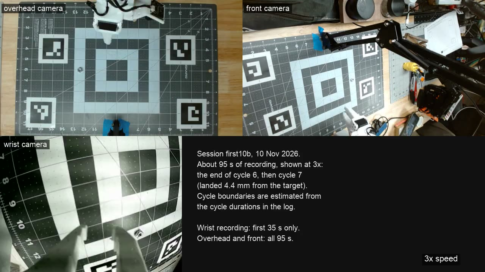

# so101-arm-lab

A small, well-instrumented robot-arm lab built around a prebuilt **SO-ARM101** (leader + follower,
Feetech STS3215 servos) running **LeRobot 0.6.1**. A Jetson Orin Nano drives the arm and the cameras,
a Mac trains policies, records, and shows a wall dashboard, and this repo holds everything that glues
the two together: calibration, camera tooling, a live map of the work mat, scripted picking, LeRobot
plugins, MLflow tracking with a model registry and a deploy path to the Jetson, and a 759-test harness that runs without any hardware.

Started 5 October 2026 by [Lastlight Goods](https://lastlightgoods.com) in Bend, Oregon.

## What is in here

| Path | What |
| --- | --- |
| `jetson/` | Jetson side. `jetson_setup.sh` (JetPack 6.2 + CUDA torch + LeRobot), `env.sh` with every `so101-*` command, `cam_calib.py` (camera and arm calibration), `cam_lock.py` / `cam_health.py` / `cam_drift.py` (camera settings lock, frame-rate and drift checks), `goto.py` / `pick_seq.py` (scripted motion), `labtrack.py` / `record_track.py` (MLflow logging for picks, calibration and recording sessions), `calib/` (the live calibration files), `JETSON_RUNBOOK.md` |
| `dashboard/` | The wall dashboard: `server.py` (stdlib HTTP, SSH streams, calibration and scene APIs), `index.html` (gauges, live feeds, 3D arm and cameras, mat map, skins), `phone.py` (the LAN gateway: a phone page, or the full panel on an iPad with `so101-dash pad`, [`docs/ipad-panel.md`](docs/ipad-panel.md)), `scene_detect.py` (objects on the mat from the overhead camera), `skins/`, `urdf/` |
| `tools/` | Mac-side helpers: `jog_capture.py` (jog-and-fit of the arm base), `pick_loop.py` (iterative pick-and-place learning), `cams.sh` / `cams_avf.py` (camera wall on monitor 2), `teleop_robust.py` (teleop that survives a stalled bus), `ping_arm.py` (raw servo ping), `clean_dataset.py` / `trim_dataset.py` (dataset repair), `film.py` (episode films), `mlflow_backfill.py` / `mlflow_ui.sh` (MLflow), `so101_policy.py` (model registry and Jetson deployment, [`docs/mlops/registry-and-deploy.md`](docs/mlops/registry-and-deploy.md)), `cf_token.py` (Cloudflare token helper) |
| `infra/` | The MLflow server as containers (`docker-compose.yml`, `Dockerfile.mlflow`, `migrate_sqlite.sh` for the SQLite store) and the same shape on AWS (`terraform/`: S3, RDS, one Fargate task), nothing applied: [`docs/mlops/infra.md`](docs/mlops/infra.md) |
| `plugins/` | LeRobot plugins: `lerobot-robot-busheal` (bus recovery, gripper limits, state relay), `lerobot-camera-avf` (AVFoundation cameras by name), `lerobot-policy-actasync` (ACT with the async engine) |
| `sim/` | Simulation rounds: ACT on a simulated pick task, cloud training notes, success tables |
| `tests/` | 759 tests, all synthetic (rendered boards and markers, fake `v4l2-ctl`, fake bus, fake `nmcli`, stub HTTP server, temp MLflow stores). `python -m pytest tests -q`, about 5 minutes |
| `docs/` | The guides below, the MLflow field guide, plus CNC panel notes from a side project |
| `env.sh` | Mac shell commands (`so101-train`, `so101-finetune`, `so101-dash`, ...) |
| `NEXT_STEPS.md` | The running log: what works, what broke and why, what is next |
| `pyproject.toml`, `requirements-dev.txt`, `.github/workflows/tests.yml` | Lint (ruff) and test configuration; CI runs `ruff check .` and the suite on every push |
| `attic/` | Unreferenced leftovers kept for the record (see `attic/README.md`) |

## The guides

- [`docs/autoloop-explained.md`](docs/autoloop-explained.md): what the arm does on its own, how, and the first ten-cycle session
- [`docs/camera-calibration.md`](docs/camera-calibration.md): checkerboard intrinsics, four 2 in ArUco
  markers on a Fiskars 18x12 in cutting mat, the arm base pose by jogging to grid points, the LeRobot
  joint zero offsets, and why wrist roll must be held constant. Also the self-healing re-solve when the
  camera stand gets bumped.
- [`docs/pick-loop.md`](docs/pick-loop.md): the closed-loop pick (`tools/pick_loop.py`). The open-loop command
  reaches 5-8 mm short; the servo readback through the arm fit is good to a millimetre, so: command, read back,
  correct twice, jaws at 35. With the 10 Nov 2026 numbers, the wrist-camera check (`tools/wrist_check.py`) and
  what each pick logs to MLflow.
- [`docs/autoloop.md`](docs/autoloop.md): the unattended session runner (`tools/autoloop.py`, `so101-autoloop`): pick to a target,
  judge from the overhead camera, reset the nut to a new spot, repeat, under the guardrails of `tools/guardrails.py` (workspace box,
  motion, perception and panel watchdogs, caps, stop file), plus the "10 in a row, attended" milestone procedure.
- [`docs/camera-settings.md`](docs/camera-settings.md): locking exposure, white balance and focus, and
  the measured behaviour of the Logitech C920 revision 046d:08e5 that makes a naive lock white out
  (gain forced to 255 after auto to manual, exposure re-derived at every stream start). A guard service
  and a udev rule keep the lock; recording refuses to start unless the cameras are locked.
- [`docs/camera-health.md`](docs/camera-health.md): frame-rate, duplicate-frame and drift checks for
  the three cameras, usable in a pre-recording checklist.
- [`docs/telemetry.md`](docs/telemetry.md): servo health (temperature, load, current, voltage, error bits, commanded vs actual) from the
  STS3215/STS3250 registers: the live panel, the per-pick MLflow numbers, polling cost and bus sharing, and the read-only hardware check.
- [`docs/mat-scene.md`](docs/mat-scene.md): the live map of the mat. Background model, kinematic arm
  mask from the follower's joints, marker-based drift refit, persistence filter, and the APIs the
  dashboard draws from.
- [`docs/mlops/README.md`](docs/mlops/README.md): the map of the MLOps stack (tracking, registry, deployment,
  containers, Terraform), the five day-to-day sequences, how it maps to standard practice and what is deliberately
  not done; with a glossary, an evening of hands-on exercises and résumé notes beside it.
- [`docs/mlops/registry-and-deploy.md`](docs/mlops/registry-and-deploy.md): checkpoints into the MLflow Model
  Registry (`so101-policy register`, local or from the Hub), `candidate` and `jetson` aliases, versioned deployment to
  `~/so101/policies/<name>/v<N>/` with a `current` symlink and `DEPLOYED.json`, one-command rollback, and what
  `so101-run` and the dashboard do with it.
- [`docs/mlops/tracking.md`](docs/mlops/tracking.md): MLflow tracking. One run per pick (`so101-picks`),
  per written calibration file (`so101-calibration`) and per recording session (`so101-recordings`), the
  LAN server, and how every logger degrades to a silent no-op when the server is not there.
- [`docs/hotspot.md`](docs/hotspot.md): the Jetson's Wi-Fi radio as the iPad's network at a show
  (`so101-hotspot`, NetworkManager AP + shared mode over an Ethernet uplink, a 10-minute revert
  watchdog, a cable-follows dispatcher and a one-port firewall). Written against fake tools; not yet
  run on the hardware.

## The arm practising alone

*Camera recordings from the overhead C920, the front C920 and the wrist camera, 3x speed, about 95 s of one session
([MP4, 2.4 MB](site/public/video/autoloop-cycle7.mp4); GitHub does not play repo videos inline).*

The session runner picks a hex nut, places it on a target, resets the mat and tries again with nobody touching it. The first
attended ten-cycle session (10 Nov 2026) landed 5 of 10 within 15 mm and stopped on a guardrail trip after cycle 10. What it
does step by step, the guardrails and the numbers are in [`docs/autoloop-explained.md`](docs/autoloop-explained.md) and on the
[site page](https://so101-arm-lab.c-thomas-clark-pdx.workers.dev/notes/practising-alone).

## Hardware

SO-ARM101 leader and follower (Waveshare bus boards, 12 V follower supply), Jetson Orin Nano on
JetPack 6.2, a Mac for training and the dashboard, two Logitech C920 cameras (overhead and front) and
an icSpring gripper camera, a Fiskars 18x12 in self-healing cutting mat as the work surface.

## Status, honestly

Calibration, camera tooling, the mat map and the dashboard are solid and tested. Scripted picking is
work in progress: the arm reaches within about 3 mm of a commanded point, but a hex nut lands 10 to
40 mm off because it shifts in the single-moving-jaw gripper. The next step is to measure the part in
the jaws with the gripper camera before placing.

## Not in the repo

Datasets, checkpoints, JetPack images and the Python environments are deliberately absent (see
`.gitignore`). They live in `~/.cache/huggingface/lerobot`, `outputs/` and on the Jetson.

## Licence

MIT, see [`LICENSE`](LICENSE). The SO-101 URDF and meshes under `dashboard/urdf/` come from
TheRobotStudio's SO-ARM100 project under Apache-2.0, see [`dashboard/urdf/README.md`](dashboard/urdf/README.md).
