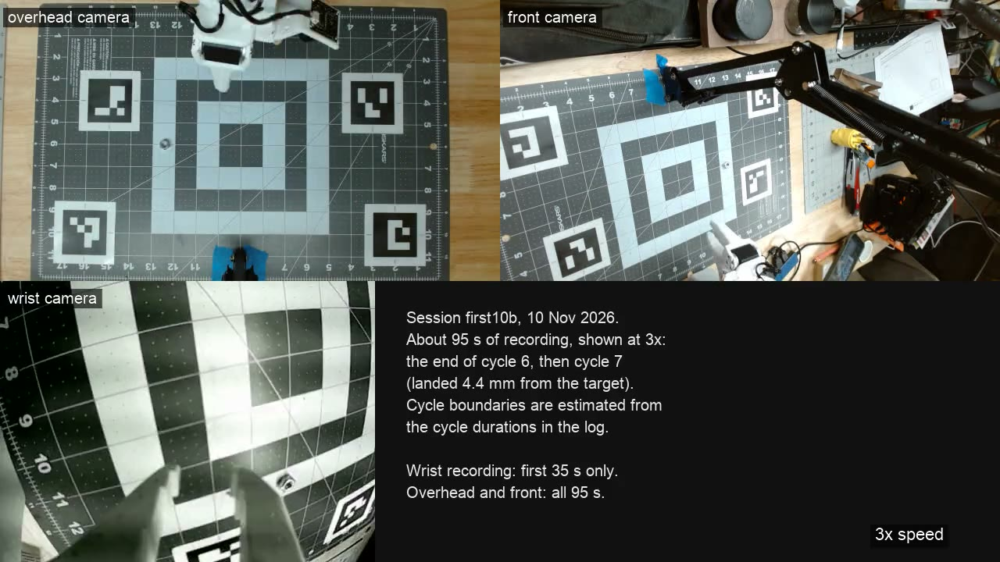

# What the arm is doing on its own, and how

This page explains the session runner ([`autoloop.md`](autoloop.md)) in one read, with a recording and the numbers from the
first attended ten-cycle session on 10 Nov 2026. The same text is on the site as
[Practising alone](https://so101-arm-lab.c-thomas-clark-pdx.workers.dev/notes/practising-alone).

*Camera recordings from the overhead C920, the front C920 and the wrist camera, 3x speed, about 95 s of session first10b
(the end of cycle 6, then cycle 7). Click for the MP4 (2.4 MB); GitHub does not play repo videos inline.*

## What I am trying to do

I want the arm to practise by itself: try a pick, judge the result, reset the mat, try again. A person resetting the nut between
every attempt is the slow part of learning from a real arm, so the first milestone is a session where nobody touches the mat.

The milestone is called "10 in a row, attended". The task is to pick a hex nut and place it on a target at mat (9, 6) in. The
bar is at least 9 of 10 cycles landing within 15 mm of the target, with zero guardrail trips. I stand at the wall STOP the whole
time.

## One cycle, step by step

1. **Guard.** Before anything moves the runner checks the stop file, that the dashboard answers, that the overhead camera sees
   at least 3 of its 4 markers, and that no LeRobot job is holding the arm.
2. **Find the nut.** The overhead camera's mat map gives the nut's position in mat inches. If the map misses it, a search over
   the whole mat image takes over.
3. **Closed-loop pick** (`closed_loop_pick` in `tools/pick_loop.py`). The nut position goes through inverse kinematics. The
   arm is commanded to a hover point, the joints it actually reached are read back, forward kinematics (`fk_mat`) turns them into
   a position on the mat, and the difference is the correction. That happens twice: once at the hover, once at the grasp height
   with the jaws open. If the tip is still more than 6 mm above the mat, the grasp is lowered. The jaws open to 35 and close in
   two steps, so the moving jaw meets the nut slowly. The numbers behind this are in [`pick-loop.md`](pick-loop.md): an
   open-loop hover came up 5 to 8 mm short, and after two corrections the grasp pose was within 0.1 mm of the command.
4. **Jaw check** (`jaw_check`). After the lift, one wrist-camera frame is searched for the nut's bright ring with a dark hole
   inside a window between the jaw tips. Not found: open, go back, grasp once more. Not found again: record a failed pick.
5. **Place and judge.** The arm carries the nut to the target and places it. After 1 s the overhead camera's map gives where the
   nut is. The cycle landed if the nut moved more than 20 mm from where it started and ended within 15 mm of the target.
6. **Reset.** The same closed-loop pick takes the nut from the target and drops it at a random spot in a safe box, x 6 to 13 in
   and y 4 to 8 in, at least 40 mm from other objects, 50 mm from marker centres and 60 mm from where it was. The next cycle
   starts from somewhere new.

Every cycle is logged to MLflow as a run in the experiment `so101-autoloop`, with the landing error, the retries and the stage
detail of each pick.

## Guardrails

The runner never talks to the arm directly. Every motion goes through one script that applies the arm's own limits, and
[`guardrails.py`](../tools/guardrails.py) decides before each step whether to go on. Any trip ends the session.

| Guardrail | What it stops |
| --- | --- |
| workspace | A planned waypoint outside the mat (shrunk by 20 mm), above 4 in, or more than 10 mm below the mat plane. The plan is never run. |
| motion watchdog | A waypoint where commanded and reached joints differ by more than 8 degrees. |
| perception | Fewer than 3 markers seen for 10 s, calibration not ok, or no scene from the overhead camera. |
| panel liveness | The dashboard does not answer within 3 s, or reports the Jetson offline. |
| arm busy | A LeRobot job (teleop, record, rollout) already holds the arm. |
| stop file | A clean stop between cycles or before any motion. |
| caps | Cycles, minutes, and 3 failed cycles in a row. |

The wall STOP cuts the arm independently of all of this.

## What happened on 10 Nov 2026

Session `first10b`: 10 cycles, target (9, 6) in, 15 mm radius, 1067 s in total.

| Cycle | Landed | Error from target (mm) | Retries | Cycle time (s) |
| --- | --- | --- | --- | --- |
| 1 | yes | 5.1 | 0 | 84.53 |
| 2 | yes | 5.7 | 0 | 84.71 |
| 3 | yes | 3.4 | 0 | 84.69 |
| 4 | yes | 7.9 | 0 | 101.71 |
| 5 | no | 4.2 (not picked, moved 1.7 mm) | 1 | 127.51 |
| 6 | no | 20.6 (not picked) | 1 | 127.86 |
| 7 | yes | 4.4 | 0 | 84.43 |
| 8 | no | none recorded | 1 | 85.09 |
| 9 | no | none recorded | 1 | 117.43 |
| 10 | no | 62.8 (not picked) | 1 | 163.83 |

5 of 10 landed (success rate 0.5), mean error 14.3 mm, median 5.4 mm, 5 retries. The runner stopped after cycle 10 with a
`consecutive_failures` trip (3 failed cycles in a row, cycles 8 to 10). That is below the bar of 9 of 10 with zero trips, so the
milestone is not met. The earlier session `first10` ran 4 cycles, landed 3 (mean error 9.2 mm) and stopped on a `run_plan` trip
in cycle 4 because a LeRobot teleop job had started and was holding the arm; the arm-busy check exists because of that.

Landed cycles were all within 8 mm of the target.

## Two things I know are wrong

- **The fixed jaw nudges the nut before the grasp.** The SO-101 has one moving jaw and one fixed jaw (the thumb). The aim point
  I command is the tip of the fixed jaw, not the centre of the open jaw gap, so the fixed jaw comes down on the nut and moves it
  before the jaws close. A fix is in progress.
- **Resets are not judged.** The runner checks where the nut landed, but not where the reset left it. In cycle 4 the reset left
  the nut on the target. Cycle 5 then started with the nut 4.2 mm from the target and the "pick" moved it 1.7 mm, which the
  judge scored as not picked.

## About the video

I started the recording partway into the session. The dashboard dropped the wrist stream after 35 s and the overhead stream after
95 s; the front stream ran on. The clip is the first 95 s of the three recordings at 3x. The wrist camera shows the end of
cycle 6; the overhead and front cameras then cover most of cycle 7, a landed cycle. I estimated the cycle boundaries from the
cycle durations in the log, so they can be a few seconds off. The nut is a small dot in the overhead view. The wrist loop
([MP4](../site/public/video/autoloop-wrist-loop.mp4)) is 5 s of the wrist recording at 3x.

## Where the code is

`tools/autoloop.py`, `tools/guardrails.py`, `tools/pick_loop.py` (`closed_loop_pick`, `jaw_check`, `fk_mat`,
`find_nut_anywhere`), and the docs [`autoloop.md`](autoloop.md), [`pick-loop.md`](pick-loop.md) and
[`camera-settings.md`](camera-settings.md).

## What is next

Fix the aim point so the nut ends up between the jaws rather than under the fixed one, judge the reset the same way as the
landing, and run the ten cycles again.
